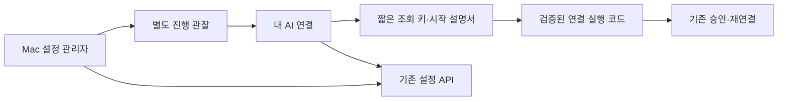

> NOTE: This is the plan, not a description of the code — never read it as evidence of current code state. While `status: active`, edit it in place as the plan changes; once archived it is frozen.

# 내 AI 연결의 명령·진행·복구·모델 설정 통합

## Context

PR38의 화면 안내만으로 사용자가 연결을 완료하거나 실패에서 복구하지 못한다. 현재 `main` 기준 `8f4441b`에서 원인을 확인했다. 이 계획은 화면 변경뿐 아니라 진행 정보 전달과 연결 명령 전달을 보완한다. 2026-10-15 사용자가 이 계획의 구현·검증·배포를 승인했다. 이 문서는 실행 계획이며 완료된 현재 상태는 아니다.

제품 범위는 [PRD 로컬 AI 연결](../PRD.md#로컬-ai-연결)을 따른다. 기존 Claude/Codex 로그인·개인 설정, Mac의 읽기 전용 저장소, 질문자 연결 선택 사항, 본인 AI 질문을 유지한다. 앱 설치나 상시 실행 서비스 설치는 추가하지 않는다.

확인한 사실:

- `local-connection-command.ts:100-160,184-215`: 새 승인 선택마다 브라우저에 저장한 복구 배열 전체를 명령에 넣는다. 같은 합성 입력의 생성 명령은 새 승인 0/1/10/32회에 각각 1,161/1,496/2,936/6,456자였다. 안전한 실행 준비 코드와 복구 배열이 합쳐진 길이다.
- `connection-manager.tsx:529-542`: 제거된 연결도 이전 연결 기록 카드로 렌더링한다. 자료 보존과 일반 화면 노출은 다른 문제다.
- `runtime-settings-form.tsx:303-406`, `settings-controller.ts:253-394`: 모델 저장과 적용이 서로 다른 사용자 버튼이며, 첫 저장 뒤 선택이 잠긴다.
- `settings/manager.ts:598-653`: 폴더 선택, 공유 승인, 모델 조회가 웹에서는 모두 `REQUESTED`로 보인다. 실패 `reason`은 로컬과 터미널에만 남는다.
- 실제 지연의 지배 원인은 아직 측정하지 않았다. Node 24가 없으면 bootstrap이 공식 실행 파일을 내려받고, 사용자의 폴더·공유 확인과 서버 조회도 기다린다. 단순히 제한 시간을 늘리거나 모든 연결이 몇 초 안에 끝난다고 약속하지 않는다.

목표: 한 화면에서 **지금 하는 일 / 기다리는 이유 / 다음 행동**을 하나씩 보여 주고, 같은 설정 저장을 여러 버튼으로 나누지 않는다. 명령 길이는 복구 횟수에 따라 증가하지 않는다.

## Decisions and boundaries

1. 기본 화면에는 선택한 현재 기기의 연결과 AI 설정만 보인다. 복구 이력·공개 ID·명령 원문은 해당 문제가 발생했을 때의 상세 화면으로 이동한다. 기록 자체를 지우지 않는다.
2. 연결 시작 명령은 만료되는 짧은 조회 키로 실행 설명서를 받는다. 설명서에는 기존 공개 연결 범위와 복구 배열만 넣는다. 로그인 키·로컬 경로·AI 설정 원문은 저장하지 않는다. **조회 키는 기기 승인, 인증 갱신, 기존 기기 변경 권한을 부여하지 않는다.** 기존 웹 승인·로컬 계정 확인·실행 보호는 유지한다.
3. 진행 정보는 관찰 정보다. 설정 확정·실행 종료 증거인 기존 receipt와 별도로 보관한다. 이를 근거로 잠금을 해제하거나 완료·응답 준비 상태를 만들지 않는다.
4. 모델·추론 강도·표시 이름은 한 설정 화면에서 고르고 **설정 저장** 한 번으로 기존 `select-runtime` → `apply`를 순차 호출한다. 요청 결과가 불명확하면 조회만 하고, 자동으로 다음 변경 요청이나 새 실행을 하지 않는다.
5. 자동 새로 확인은 연결/설정 화면에서 사용자가 시작한 진행 작업에만 적용한다. 공통 메뉴의 연결 표시를 자동 갱신하지 않으며 AI 질문도 실행하지 않는다.
6. 재시도는 현재 작업 확인/같은 연결 재실행을 먼저 제공한다. 새 승인이 실제 필요한 경우에만 별도 확인을 받는다. 일상적인 새 명령 복사나 만료된 조회 키 갱신은 복구 배열을 늘리지 않는다.

## Affected Files

운영 변경 18개. 구현 중 빠진 운영 의존성이 확인되면 이 활성 계획에 반영한다. 테스트·문서와 기존 소비자는 아래 별도 목록이다.

1. `src/features/connection-setup/contracts.ts` (신규): 시작 설명서·진행 관찰의 제한된 계약과 검증.
2. `src/features/connection-setup/service.ts` (신규): 세션/기기/조회 키별 RPC 및 응답 투영.
3. `src/app/api/connection-setup/[action]/route.ts` (신규): 명령 발급·조회·시작 보고·설정 진행 보고·소유자 조회.
4. `supabase/migrations/20261015002100-connection-setup-observation.sql` (신규): 제한된 임시 설명서와 진행 관찰, RPC·소유권 검사.
5. `src/features/connection-setup/setup-controller.ts` (신규): 화면의 명령 발급, 해당 시작·설정 작업 조회, stale/오류 표시. React에서 독립된 단위 검증 경계.
6. `src/features/connection-setup/setup-status.tsx` (신규): 한 상태 요약, 주 행동, 필요한 문제 해결 상세.
7. `src/features/device-binding/local-connection-command.ts`: 고정 길이 명령 생성. 기존 복구 선택 파서는 유지.
8. `src/features/device-binding/local-connection-guide.tsx`: 한 번 복사, 명령 발급/만료/재개와 복구 진입.
9. `scripts/local-connection-bootstrap.sh`: 설명서 검증 후 기존 인자로 연결 실행, 제한된 시작 상태 보고.
10. `packages/local-connector/src/settings/setup-observer.ts` (신규): 기기 인증을 사용하는 진행 보고. 로그 원문을 전달하지 않는다.
11. `packages/local-connector/src/settings/manager.ts`: 실제 단계 경계에서 observer 호출, 폴더 결과와 기존 실패 코드 분류. 기존 journal/receipt 불변 조건 유지.
12. `src/features/device-binding/connection-manager.tsx`: 한 현재 연결 카드와 단계 전환·복구 상세, 제거 기록 기본 노출 제거.
13. `src/features/runtime-settings/settings-controller.ts`: 한 저장 의도 안에서 정확한 선택 확인 후 적용. 조회 유실과 중복 클릭 제어.
14. `src/features/runtime-settings/runtime-settings-form.tsx`: 한 설정 폼·저장 버튼·적용 결과 및 연결된 상태 안내.
15. `packages/local-connector/src/settings/setup-contracts.ts` (신규): observer가 쓰는 작은 공개 관찰 계약의 동일 사본. 파일 일치 검사로 유지.
16. `packages/local-connector/src/settings/client.ts`: 새 observe 메서드로 관찰 API의 제한된 HTTP 전송을 제공한다. 기존 call의 결과 계약은 유지하고 본문 크기·timeout·redirect 정책을 공유한다.

17. `scripts/apply-local-ai-settings.mjs`: 새 migration/hash 허용 목록과 설치 여부 검사·선택 적용에 연결. 기존 검증된 본문 해시를 바꾸지 않는다.

18. `src/features/connection-setup/setup-contracts.ts` (신규): connector 관찰 계약의 웹 사본. byte 동일성 테스트로 유지한다.

## Affected Dependents

### 코드

- `src/app/app/connections/page.tsx:55-61` → `ConnectionManager` 호출과 본인 기기 목록. 기존 page props 계약 유지.
- `connection-manager.tsx:469-477` → `RuntimeSettingsForm`, 선택 deviceId와 방 변경 격리 유지.
- `src/features/device-binding/connection-presence.ts:26-61`, `owned-connection-status.tsx:19` → 최근 통신의 90초 판정. 실행 중/응답 준비와 합치지 않는다.
- `src/features/runtime-settings/settings-client.ts:9-64`, `contracts.ts:327-490`, `packages/local-connector/src/settings/contracts.ts` → 기존 runtime-settings 계약 사본은 바꾸지 않는다. 새 관찰 endpoint를 분리해 구버전 exact 검증과 호환한다.
- `src/app/api/runtime-settings/[action]/route.ts`, `runtime-settings/service.ts` → 기존 설정 API/RPC 유지.
- `packages/local-connector/src/cli.ts:532-621` → 관리자를 생성하는 connect/manage 모두 관찰 대상. 공개 생성자 인자를 늘리지 않고 manager가 현재 store/client를 사용한다.
- `packages/local-connector/src/cli/connection-recovery.ts:55-127`, `parse-options.ts` → 설명서에서 복원한 기존 profile/chain 인자로 재사용. 자동 기록 삭제, 새 프로필 우회, 정리 증거 생략 금지.
- `packages/local-connector/src/cli/settings-status.ts:5-70` → 기존 터미널 안내 유지. 웹이 받지 못한 상태는 터미널에서 확인 가능해야 한다.
- `scripts/build-local-connection.mjs:53-80,162-187` → 새 connector 파일 자동 수집과 배포 해시 검증. public 빌드 파일은 직접 편집하지 않는다.
- 기존 SQL `20261005001000:186-196,295-335,424-473`, `20261006001200:34-48,84-101`, `20261008001600` → 인증·설정 고정·적용·취소 receipt 비교는 새 migration에서 대체하지 않는다. 새 RPC는 기존 살아 있는 기기 검사와 본인/방 소속 검사를 사용한다.
- 테스트 fixture `tests/helpers/local-access-stack.ts`, `settings-browser-fixture.ts` → 새 migration 적용 및 실제 인증·폴링 검증. 기존 준비 heartbeat와 operation ID를 재사용한다. fixture가 새 migration을 자동 적용한다고 가정하지 않는다. `scripts/apply-local-ai-settings.mjs:11-52,450-457`의 허용 목록·설치 판정을 갱신한 뒤 격리 DB에 명시적으로 적용/확인한다.

### 문서 사본

아래는 현재 정본에서 확인한 위치 수이며 소유 선언은 `unstated`다. 이 저장소의 관련 절만 갱신하며 외부 팀의 소유 선언을 만들지 않는다.

| 바뀌는 규칙 | 확인한 사본 | 위치 |
|---|---:|---|
| 제거 기기 ID를 이전 연결 기록에서 확인 | 3개 문장 | `docs/FRONTEND-ARCHITECTURE.md:44` 2개, `docs/guides/onboarding-and-settings.md:107` 1개 |
| 모델 확인·설정 적용을 두 버튼으로 수행 | 2 | `docs/guides/onboarding-and-settings.md:125,127` |
| Mac→폴더→모델 3단계 안내 | 5 | `docs/guides/onboarding-and-settings.md:18-21`, `docs/FRONTEND-ARCHITECTURE.md:50` |
| 새 진행/원인 관찰 계약 | 0 (신규) | 갱신할 절: `docs/API-SPEC.md:132-148`, `docs/DB-SCHEMA.md:116-128`, `docs/ARCHITECTURE.md:24,165` |

연결 명령·복구의 현재 안내는 `docs/guides/onboarding-and-settings.md:76-108`, 프론트엔드 정본과 함께 수정한다. 취소 접수와 정리 완료의 구분은 `BUSINESS-LOGIC.md:74`, `API-SPEC.md:146`, `DB-SCHEMA.md:124`, `FRONTEND-ARCHITECTURE.md:146`, onboarding `:23,87,357`에 있고 유지한다. 요청값/적용값 구분은 `PRD.md:58`을 유지한다. 오류 원문 비공개는 onboarding `:464`를 유지한다.

검색 범위: 위 현재 정본과 실제 src/packages/scripts. `ADR`, `archive`, `records`의 역사 문장은 사본 수에서 제외하고 수정하지 않는다. 실행 후 검증 상태는 `docs/planning/delivery-and-validation.md` 한 곳에 기록한다.

## Change Map



- `onboarding-and-settings.md:125,127 --restates--> 두 사용자 버튼`은 하나의 설정 저장 절차로 갱신한다.
- `FRONTEND-ARCHITECTURE.md:44 --restates--> 제거 기록 기본 화면`은 문제 해결 상세 진입으로 갱신한다.

## Implementation Steps

### [x] Step 1: 제한된 실행 설명서와 관찰 계약

**Files**: 신규 contracts/service/route/migration/setup-contracts.

- 새 API는 모두 POST, 원문 body 최대 16KiB, no-store, redirects 거절. 사람 action은 현재 origin·세션 검증, 기기 action은 기존 bearer와 살아 있는 기기 검증. 사람 action=`issue`, `inspect`; 시작 조회 키 action=`resolve`, `startup-report`; 기기 action=`settings-inspect`, `settings-report`.
- `issue` 입력은 `requestId`, `roomId`, `deviceAlias`, 기존 검증된 `ConnectionSelection`. owner는 세션에서, organization은 참가 방에서 유도한다. 기존 origin/user/room 기반 baseProfile 검증을 다시 수행한다. 같은 requestId/동일 본문은 같은 설명서의 메타데이터만 반환하고 다른 본문은 충돌이다. 키 원문은 최초 발급 응답에만 포함한다.
- 설명서는 `{version:1, origin, ownerUserId, organizationId, roomId, deviceAlias, selection}`만 허용한다. 기존 선택 파서와 문자열/UUID 검증을 적용한다. 서버가 만든 정확한 UTF-8 JSON 문자열과 SHA-256을 보관한다. 원문을 shell 코드로 사용하지 않는다.
- 새 조회 키는 CSPRNG 32바이트, 서버에는 해시만 저장한다. 반환 원문 키는 발급 응답/현재 브라우저 메모리/명령에만 둔다. 동일 issue의 응답 유실 복구에는 재생 가능한 키를 별도 비밀 저장하지 않고 새 requestId로 같은 selection의 설명서를 재발급한다. 새 기기나 새 복구 세대를 만들지 않는다. 동일 requestId 재호출은 키 원문을 재생하지 않고 발급 존재 여부와 재발급 안내만 반환한다.
- 조회 가능 기간 30분. 같은 키의 반복 resolve는 기간 내 허용한다. 실행 중복은 기존 로컬 잠금이 막는다. 기기 승인 권한을 부여하지 않는다. resolve 때 현재 owner 방 membership을 다시 확인한다. 키는 URL query/경로·로그에 넣지 않고 POST body/Authorization으로 전달한다.
- 새 임시 테이블은 private schema, RLS/직접 DML 차단, SECURITY DEFINER 함수의 빈 search_path와 최소 grants. 최대 32개 미만료 발급/사용자, 24시간 128회 발급 제한. 보존은 24시간, 발급/조회 시 만료 자료를 제한된 수로 정리한다. 공유 DB 다른 사용자 자료는 운영 코드의 제한된 정리 정책 외 접근하지 않는다.
- `startup-report`는 bootstrap 실행마다 새 UUID `attemptId`와 해당 실행 내 증가하는 `sequence`를 포함한다. 서버는 첫 보고 때 attempt 순서를 할당하며 같은 attempt/seq/본문은 멱등, 같은 seq의 다른 본문과 역순은 거절한다. 키당 시도 최대 8개다. 키에서 처음 접수한 attempt를 추적 대상으로 고정하며 같은 키의 두 번째 실행이 이를 교체하지 않는다. 다른 attempt의 RUNTIME_BUSY는 해당 중복 실행에만 속하고 첫 실행의 승인 대기를 실패로 바꾸지 않는다. 사용자가 화면에서 재시도를 명시하면 같은 selection의 새 조회 키를 발급하고 그 키의 첫 attempt를 추적한다. 같은 명령을 다시 실행해도 기존 기기/설정의 권위 있는 응답이 오면 그 정본이 우선하며, 보고 없는 첫 실행을 자동 실패/완료로 만들지 않는다. 같은 키 재실행에 따른 중복 프로세스 실패가 이미 인증된 현재 기기/PC 설정 정본을 덮지 않는다. 해당 키의 enum만 받는다: 준비 중/다운로드/연결 실행/실패. `reason`은 허용된 bootstrap/연결 오류 코드, `receivedAt`은 서버 시각. 최신 한 건만 유지한다. 이 보고는 **기기 인증되지 않은 관찰**임을 계약에 명시하고 연결 성공·설정 적용 권한으로 사용하지 않는다.
- `settings-report`는 현재 기기 credential, 정확한 device/operation/configRevision을 확인한다. 필드는 제한된 `stage`, `reason`, `sequence`이며 서버 수신 시각을 붙인다. 기존 operation/receipt는 변경하지 않는다. 다른 기기/방/사용자 또는 지난 operation·revision의 보고는 거절한다. seq는 현재 operation 안에서 단조 증가하고 같은 seq/같은 본문은 멱등, 다른 본문은 거절한다. 새 observer는 먼저 `settings-inspect`로 해당 현재 operation의 마지막 seq를 조회해 이어간다. 이는 현재 device credential로 본인 operation만 조회하며 owner용 inspect와 다르다. 읽기 실패 시 보고를 건너뛰고 실행 상태는 바꾸지 않는다. 기존 로컬 settings lock으로 한 관리자가 해당 operation을 소유한다.
- 관찰 stage: `FOLDER_SELECTION`, `SHARING_CONFIRMATION`, `MODEL_DISCOVERY`, `MODEL_SELECTION`, `APPLYING`, `CANCELLING`, `FAILED`. 성공·취소 완료는 기존 receipt로만 결정한다. raw stderr, 절대 경로, 모델 응답, 토큰은 수용하지 않는다. 원인이 불명확하면 `UNCONFIRMED`로 표시한다.
- `inspect`는 소유자에게만 시작 관찰/현재 operation 관찰/현재 등록 기기·인증 상태를 반환한다. 완료·해제 상태는 기존 정본을 참조한다. 동료나 observer는 이 개인 진단을 조회할 수 없다. 새 API 실패는 기존 AI 실행 상태를 변경하지 않는다.

### [x] Step 2: 복구 횟수와 무관한 명령 및 시작 안내

**Files**: command/guide/bootstrap/setup-controller.

- 기존 검증 launcher의 환경 정리, HTTPS 또는 loopback, redirect 금지, 다운로드 크기·시간·SHA-256 확인을 유지한다. 명령에는 origin, 검증 bootstrap 경로/hash, 조회 키와 설명서 hash만 전달한다. 복구 배열은 넣지 않는다. 고정 입력에서 복구 0/1/10/32회 명령 길이가 같아야 한다.
- bootstrap은 새 명령 모드와 기존 5/7/8 인자 모드를 모두 지원한다. 새 설명서는 크기·hash·UTF-8·version·scope·alias·기존 chain 규칙을 검증한 후 기존 connect 인자로 전달한다. JSON 값을 eval/source하거나 쉘 코드로 합성하지 않는다. 누락·변조·만료이면 연결 실행 전 실패한다.
- Node 준비 이전 실패도 터미널에 단계별 한국어 원인을 표시한다. 가능한 경우 키로 실패 enum을 제한시간 2초·최대 1회 보고한다. 보고 실패는 원래 오류를 덮거나 종료를 지연하지 않는다. HTTP 차단·터미널 강제 종료는 웹이 원인을 받지 못할 수 있으므로 그 경우는 ‘실행 상태가 도착하지 않음’으로 표시한다.
- 기존 브라우저 선택을 한 번 읽어 issue에 전달한다. 조회 키는 복구 세대를 만들지 않는다. 명령 재복사/키 만료 재발급은 같은 selection을 사용한다. 기존 새 승인 확인을 거쳐야만 `nextConnectionSelection`을 호출한다.
- 기본 화면은 ‘연결 명령 복사’ 한 버튼과 터미널 실행 안내, 복사 이후 ‘Mac에서 실행 기다림’을 보여 준다. 원문은 실패 시 직접 복사가 필요한 상세에서만 제공한다. 키 만료는 ‘새 명령 복사’로 복구한다.
- 새 명령은 특정 선택 기기의 원격 실행 명령이 아니다. 이 브라우저 owner/room의 로컬 profile을 사용함을 유지한다. 여러 기기가 있을 때 임의의 기기에 성공을 연결하지 않는다. 현재 approve 응답에는 deviceId가 없다(`contracts.ts:339`). 이를 추측해 새 기기와 연결하지 않는다. 등록 대기 시작 시점의 목록과 비교해 같은 방의 신규 활성 기기가 정확히 하나인 경우 그 기기를 설정 대상으로 제안하고, 둘 이상이면 기기 선택을 요구한다. 이전에 명시적으로 선택한 유효 deviceId는 유지한다. 시작 보고만으로 성공 판정을 하지 않는다.

### [x] Step 3: 실제 작업 단계와 원인 전달

**Files**: setup-observer, manager, settings/client.

- 기존 `choose()`의 폴더 호출 직전, 공유 확인 직전, catalog 조회 직전에 관찰을 보낸다. applying/cancelling/실패는 기존 상태 전환 위치에서 보낸다. `finally` 한 번만 실행되는 현재 터미널 callback에 의존하지 않는다.
- observer는 별도 HTTP 경로를 사용한다. 진행 보고는 동시 1개, 최신 변경으로 합치고 2초 상한, 응답이 실패하면 다음 실제 단계 변경 때만 재시도한다. unbounded queue/timer 금지. 보고 실패가 작업·정리·receipt 기록을 실패로 만들지 않는다. stop 시 새 보고를 막고 in-flight 종료를 기다리는 시간은 2초 이하로 제한한다.
- 폴더 결과의 TIMEOUT/DENIED/UNSUPPORTED/FAILED를 소유자용 reason으로 보존한다. 공유 확인의 현재 `{confirmed:false}`는 ‘공유 확인 미완료’로만 표시하며 사용자 취소/시간 초과를 임의로 단정하지 않는다. 더 세밀한 분류를 위해 모든 adapter를 바꾸지 않는다.
- `PROVIDER_UNAVAILABLE`는 ‘AI 프로그램 준비 실패’로 표시하고 설치/로그인 중 어느 것인지는 단정하지 않는다. `RUNTIME_BUSY`, `SNAPSHOT_CHANGED`, `POLICY_UNCONFIRMED`, `CONTEXT_UNCONFIRMED`, `CLEANUP_INCOMPLETE`, 인증/네트워크 오류는 각각 허용한 안내와 행동으로 연결한다.
- 적용 전 확정 실패 복구를 제한적으로 보완한다. `prepare():818-819`의 SNAPSHOT_CHANGED 등 현재 `failure():1090-1116`이 알려진 실패로 분류하는 경로 중, 현재 프로세스에서 phase가 APPLYING이고 applyBody가 있으며 context/settings/commitBody가 없고 PREPARE_INTENT에 들어가지 않은 경우에만 사용한다. 기존 기기·operation·revision·binding을 다시 확인하고 adapter.close가 성공한 뒤, 기존 `CANCEL_INTENT` + 정확한 `CANCELLED` receipt를 같은 로컬 원자 저장으로 보존한다. 새 ‘완료’ 개념이나 journal 필드는 만들지 않는다. 이 receipt는 현재 cancel()이 정리 후 저장하는 것과 같은 증거다.
- 위 정리 증거가 있는 경우 서버 APPLYING에는 같은 candidate 본문의 FAILED receipt를 먼저 전달한 다음 CANCELLED를 전달한다. 서버가 FAILED/UNKNOWN이면 CANCELLED만 전달한다. 정상 응답을 확인한 뒤 로컬 CANCELLED로 닫는다. 중간 응답 유실/재시작은 같은 operation·binding·apply 본문을 검증하고 저장된 정확한 receipt만 재전달한다. 이미 COMMITTED/APPLIED인 경우 기존 adopt 경로를 따르고 취소로 덮지 않는다. `recoveryAction`은 저장된 정확한 CANCELLED receipt를 정리의 정본으로 사용한다. 응답 유실을 처리하는 기존 failure()가 로컬 phase를 UNKNOWN으로 바꾸더라도 위 조건의 UNKNOWN+CANCELLED는 같은 재전달 경로에 포함한다. 서버 APPLYING에 먼저 보낼 FAILED는 저장된 CANCELLED에서 state만 바꿔 파생한다. 서버 COMMITTED/APPLIED의 adopt가 먼저이며 증거 없는 UNKNOWN을 이 경로로 통과시키지 않는다. 기존 사람 cancel 금지와 SQL candidate_receipt_ok는 그대로 유지한다.
- 과거 FAILED라는 이름만으로 정리됐다고 추정하지 않는다. 기존 FAILED/UNKNOWN에 정리 receipt가 없거나 context/settings/commitBody가 있으면 자동 해제하지 않으며 ‘이전 실행 확인 필요’ 상세로 보낸다. 새로운 증거로도 안전 정리를 입증하지 못하면 해제 완료를 표시하지 않는다. 이 과거 상태의 자동 치유는 수용 완료 범위에서 제외하고 남은 조건으로 보고한다.
- `settings/store.ts`의 exact parser/receipt immutability는 읽기·검증 의존성이다. 필드/스키마 변경 없이 기존 CANCEL_INTENT/CANCELLED 전환 검사를 통과해야 하며, 새 증거 필드를 요구하게 되면 구현 전에 이 계획의 저장 호환 범위를 다시 검토한다.
- 구버전 연결기에는 보고가 없다. 기존 기능을 실패시키지 않고 ‘세부 상태를 받지 못함’과 같은 연결을 안전하게 재시작하는 안내를 제공한다. 서버 조회 불가와 Mac 무응답을 구분한다.

### [x] Step 4: 한 화면의 연결·복구 흐름

**Files**: manager/guide/setup-status/setup-controller/runtime-settings-form.

기본 화면:

```text
내 AI 연결                       [방 선택]
내 Mac · 연결 확인 / 설정 중 / 준비됨 / 확인 필요
현재 하는 일 한 문장
[지금 필요한 행동 하나]

Claude 또는 Codex | 공유 폴더
모델              | 추론 강도
[설정 저장] 또는 [채팅으로 이동]
```

- 여러 활성 기기는 선택형 카드로 유지한다. 기존 소유권·기기 수 정책을 바꾸지 않는다. 기기 선택과 로컬 명령의 identity가 다를 수 있는 경우를 감추지 않는다.
- 현재 단계만 펼친다. 승인 링크로 진입하면 동의 확인을 우선하고, 등록 이후 AI/폴더와 모델 설정으로 자연스럽게 이동한다. 성공한 승인 링크 재소비 방지는 유지한다.
- 제거된 기록의 상시 섹션을 없앤다. 실패 시 ‘연결 문제 해결’ 상세에서 현재 복구에 필요한 이전 ID/상태만 보여 준다. 해당 ID를 확정할 수 없으면 ‘연결 기록 확인’에서 본인 목록을 볼 수 있게 한다. 삭제·취소·새 승인은 별개 행동임을 유지한다.
- 최근 통신, 현재 설정 단계, PC 적용 완료, 실제 AI 응답 준비를 각각 구분하되 사용자 화면의 주요 상태는 하나다. ‘설정 적용 완료’만으로 ‘질문 가능’이라고 표시하지 않는다.
- 폴더 창 대기: ‘Mac에서 폴더를 선택하세요’. 모델 조회: ‘사용 가능한 모델 확인 중’. 느린 단계는 마지막 보고 시각과 ‘아직 결과가 도착하지 않았습니다’를 표시한다. 시간을 넘겼다는 이유만으로 실패/정리 완료를 만들지 않는다.
- 연결/설정 페이지에서 사용자가 시작한 작업만 2.5초 간격으로 관찰한다. 한 번에 한 요청, hidden tab/종료에서 중지, 최대 5분 적극 확인 후 수동 ‘상태 다시 확인’으로 전환한다. 다른 방/기기의 늦은 응답은 버린다. 메뉴의 수동 확인 정책은 유지한다.
- 복구 행동은 현재 근거에 맞춰 제공한다: 키 만료→새 명령 복사; 통신 없음→같은 명령으로 연결 재개; 폴더/권한 실패→기존 취소와 PC 정리 확인 후 폴더 다시 선택; catalog 변경→위 적용 전 안전 정리 증거가 확인된 경우에만 모델 다시 선택; 미확정 적용/정리→같은 요청 상태 확인. 버튼이 허용되지 않는 이유는 버튼 바로 옆 한 문장으로 표시한다.
- `RUNTIME_BUSY`나 정리 미확정에 ‘다시 연결’로 새 profile을 만들거나 기록을 삭제하는 우회는 제공하지 않는다. 상세에서 기존 터미널과 해당 연결을 확인하고, 기존에 승인된 안전한 복구 절차로 이어간다.

### [x] Step 5: 모델 설정 한 번 저장

**Files**: settings-controller/runtime-settings-form.

- 실제 PC catalog의 기본 모델·defaultEffort를 초안으로 제시하고 저장 전에는 자유롭게 바꾼다. 지원하지 않는 effort는 표시하지 않는다. ‘추론 강도’의 짧은 설명을 붙이고 provider의 실제 값은 유지한다.
- 공개 세션 별칭은 실제 이전 적용 별칭 또는 검증된 기기 별칭으로 기본 제안하며 수정 가능하게 한다. 비밀/절대 경로를 기본값으로 넣지 않는다.
- `save()`는 한 intent에 deviceId/operationId/configRevision/snapshotHash/선택값/별칭/binding identity를 고정한다. 중복 클릭·poll·방 변경과 경합하지 않는 controller 잠금을 가진다.
- 아직 저장되지 않은 선택은 기존 `select-runtime`을 한 번 호출한다. 정상 응답에서 같은 identity와 정확한 서버 선택을 확인한 경우에만 기존 `apply`를 한 번 호출한다. 이미 서버 선택이 같은 경우에도 명시적 저장 클릭과 현재 검증을 거쳐 apply한다.
- 첫 요청 결과 유실, 실패, snapshot/기기/binding 변경이면 apply하지 않는다. 같은 operation을 list로 확인하고 원래 저장 의도와 결과를 사용자에게 표시한다. 확인된 선택에서 ‘저장 계속’은 명시적 클릭으로 제공한다. 새로고침 후 자동 적용하지 않는다.
- selection_body는 서버에서 고정된다는 기존 규칙을 유지한다. 이미 선택 저장만 된 상태에서 다른 모델을 원하는 경우 같은 요청 정리 후 새 설정으로 진입하도록 명확히 안내한다. 로컬 초안만 바꿔 적용한 것처럼 보이지 않는다.
- APPLIED receipt가 와야 적용 완료로 전환한다. 기존 설정은 작업 중에도 구분해 표시하고, cancel 요청만으로 초기 상태로 되돌리지 않는다.

### [ ] Step 6: 통합 검증·문서·배포

- 아래 Tests/Verification을 실행한다. 구현 리뷰는 새 Sol xhigh reviewer가 인증·권한·동시성·호환성을 확인한다.
- 문서는 현재 정본의 해당 절만 갱신하고, 정상·실패·재개를 실제 실행 결과와 구분해 기록한다. 이 계획은 수용 검사 후에만 done/archive 처리한다.
- GitHub Flow: 작업 브랜치→PR→필수 검사→기존 사용자 병합·배포 승인 범위의 main 반영. DB additive migration 선행→웹/배포 연결 코드 후행. 이전 웹/연결기가 새 migration에서 정상 동작하는지 확인한다.
- 운영 DB에 테스트 사용자/가짜 실패를 만들지 않는다. 실제 AI 질문 추가 없이 합성 폴더·가짜 provider와 실제 로컬 HTTP/DB/브라우저로 흐름을 검증한다. 실제 Mac 선택창/기존 로그인 수용은 가능한 별도 검증으로 기록하고 대체 검사를 실제 수용으로 부르지 않는다.

## Tests

변경 전 재현 테스트를 먼저 작성하고 실패를 확인한다.

- `tests/unit/local-connection-command.test.ts`: 복구 0/1/10/32회 동일 길이, scope/chain 검증, shell injection 거절, 구 명령 유지 경계.
- `tests/unit/local-connection-guide.test.ts`: 복사 재시도·키 만료는 generation 불변, 늦은 다른 방 응답 무시, clipboard 실패 직접 복사.
- 신규 `tests/unit/connection-setup.test.ts`: issue/resolve 계약·enum/private data 거절, 생성 payload hash, 상태 우선순위, 적극 polling의 숨김/종료/5분 상한, 구버전 보고 없음.
- `tests/unit/local-connection-bootstrap.test.ts`: 새/구 인자, 설명서 변조·과대·만료·redirect·잘못된 scope/chain 거절; 보고 실패 시 원래 오류 유지; 기존 종료 증거/cleanup 유지.
- `tests/unit/runtime-settings-view.test.ts`: 한 저장은 정확히 select→apply, 첫 응답 유실·변경된 binding이면 apply 0회, 두 번째 응답 유실 재호출 0회, 중복 클릭, 중간 navigation, 명시적 저장 계속, 기존 적용값 보존.
- `tests/unit/connection-navigation.test.ts`, `local-connection-product.test.ts`: 상시 제거 기록 없음·복구 상세에서 ID 접근 가능·여러 기기와 연결 명령 범위 혼동 없음·승인 hash 재소비 회귀 유지.
- 신규 `packages/local-connector/tests/setup-observer.test.ts`: 계약 사본 동일성, seq 재개/역순/중복, 진행 보고 중 취소·stop, 네트워크 실패와 실제 작업의 독립성.
- `packages/local-connector/tests/runtime-settings.test.ts`: 폴더→공유→모델 단계, 실패 원인, 기존 receipt byte identity, 정리 미확정 잠금 유지. APPLYING 단계 SNAPSHOT_CHANGED→cleanup→정확한 FAILED/CANCELLED→새 설정 가능, 정리 증거 저장 직후/각 네트워크 응답 유실 후 재시작, cleanup 실패·PREPARE_INTENT 이후·과거 FAILED에는 자동 해제 없음. `packages/local-connector/tests/settings-store.test.ts`에서 기존 immutable CANCELLED receipt로만 전환하는지 검증한다. 실제 AI 대신 기존 fake provider.
- 신규 `tests/integration/connection-setup.test.ts`: 인증 없는 issue/inspect 차단, 타 사용자/observer/타 방·기기/만료 credential 차단, malformed JSON, 키 만료·기간 내 재조회·멤버십 상실·할당량·중복 issue, observer의 권한 없음, 이전/다른 operation 보고 거절, 설정 receipt/RLS 회귀. 동일 키 실행 A/B의 늦은 보고와 RUNTIME_BUSY가 기기 정본을 덮지 않는지 확인한다. `tests/unit/local-settings-upgrade.test.ts`에 새 migration의 미설치/설치/부분 설치 판정을 추가한다.
- `tests/integration/owner-local-ai-setup.test.ts`: 한 버튼 순차 호출의 기존 DB 계약, 선택 저장 유실/적용 유실/취소 경쟁.
- `tests/e2e/device-workspace-binding.spec.ts`, `owner-local-ai-setup.spec.ts`: PC/390px 모바일의 신규·재연결·만료·명령 실패·폴더 대기/취소·모델 조회 실패·저장·중단 후 재개. 사람 대신 합성fixture로 승인→등록→설정→대상 준비까지 실제 웹/HTTP/DB를 통과한다.

## Risks

- 진행 관찰이 기존 receipt에 섞이면 복구 동일성이 깨진다. 별도 저장·API와 기존 상태 우선순위로 차단한다.
- 짧은 키는 새 유출 표면이다. 인증 권한 없는 제한된 설명서, 30분 TTL, 해시 저장, 로그 제외, 본인 조회, 최소 필드로 제한한다.
- 신규 발급 장애 때문에 새 연결이 시작되지 않을 수 있다. 기존 실행 중 연결과 구 명령은 유지하고, 실패 원인과 재발급 행동을 표시한다. 조용히 새 profile로 바꾸지 않는다.
- 사용자가 종료한 터미널·네트워크 단절의 원인을 웹에서 확정할 수 없는 경우는 남는다. 마지막 보고와 미수신을 구분하고 근거 없는 실패 이유를 만들지 않는다.
- 실제 연결 속도 개선은 측정 전 단정하지 않는다. 준비 단계·수신 시각을 보여 멈춤과 대기를 구별하고, 시험에서 단계별 시간을 기록한다. 런타임 캐시/상시 프로세스 설치는 이번 범위 밖이다.
- 기존 FAILED/UNKNOWN 중 정리 증거가 없는 과거 작업은 이번 변경만으로 자동 복구된다고 보장하지 않는다. 안전한 새 실패의 정리와 기존 미확정 실행은 구분한다.
- 이전 기록 UI를 완전히 삭제하면 과거 ID 대조 복구가 끊긴다. 문제 발생 시에만 필요한 기록에 접근하는 경로를 둔다.

## Verification

- Node는 프로젝트의 24.x를 명시해서 사용한다. 현재 도구 기본 PATH는 Node20이므로 그 상태로 native TS를 실행하지 않는다.
- `npm run typecheck`, `npm --prefix packages/local-connector run typecheck`, 관련 unit/connector tests와 전체 unit, `npm run lint`, `npm run build`.
- 신규 integration은 기존 로컬 fixture/runner에 포함하여 실행한다. 실제 설정이 loopback·이 프로젝트 소유인지 확인한다. 임시 DB가 필요하면 검증 동안만 구동하고 종료 후 이 프로젝트 컨테이너를 중지한다. 공유 운영 DB에서 회귀 검사를 하지 않는다.
- Playwright의 실제 브라우저로 desktop/mobile 정상·실패·재개 검증, 요청 개수와 단계 지연 기록. 텍스트 스냅샷만으로 완료하지 않는다.
- 커밋 전 `npm run format`, `npm run format:check`, `git diff --check`; 사용자 변경 `next-env.d.ts`는 보존한다.
- 새 독립 reviewer의 승인 후 PR. 운영 반영 시 exact main SHA·Vercel READY·별칭·배포 assets/manifest hash·비인증 접근 거절을 확인한다. 실제 AI 입력은 이 계획에서 추가하지 않는다.

## Review Notes

독립 Sol xhigh 계획 리뷰 2회 완료. 1차 HIGH 2건과 migration 경로 보완을 수용했고, 2차에서 모두 해소되어 No issues found 판정을 받았다. 2차가 명시한 비차단 주의인 UNKNOWN+CANCELLED 재전달을 Step3에 명료화했다. 2026-10-15 사용자가 구현·검증·배포를 승인했다. 진행 표시는 각 단계의 구현·검증 결과에 따라 갱신한다.

| Finding | Severity | Disposition | Rationale |
|---|---|---|---|

| 1차: 적용 후 FAILED의 모델 재설정 경로 부재 | HIGH | ACCEPTED | Step3에 현재 실행의 APPLYING·후보 준비 전·정리 성공에만 기존 CANCEL_INTENT/CANCELLED 증거를 재사용하는 경로와 재시작 검사를 추가했다. 증거 없는 과거 FAILED의 자동 복구는 약속하지 않는다. |
| 1차: 같은 키의 여러 시작 보고가 서로 덮임 | HIGH | ACCEPTED | Step1에 attemptId/sequence, 키의 첫 실행 고정·명시적 재시도만 추적 대상 변경, 현재 기기 정본 우선순위와 중복·역순 검사를 명시했다. |
| 1차: 로컬 migration 적용 경로 누락 | MEDIUM | ACCEPTED | scripts/apply-local-ai-settings.mjs의 hash 허용 목록·설치 상태 판정과 격리 DB 적용 검사를 범위에 추가했다. |

| 2차: 수정 계획과 영향 범위 | PASS | RESOLVED | 적용 전 안전 정리·중복 시작 보고·migration 적용 경로를 재검토해 차단 없음. UNKNOWN+CANCELLED는 기존 재전달 요구를 명확히 한 구현 주의로 반영. |

### 구현 리뷰 결과

- 1차 HIGH 3건을 수용했다. 응답 유실 뒤 검증된 종결과 새 operation의 저장 표시 초기화, 기존 기기의 재통신과 새 등록 구분, 초기 조회 실패 후 수동 복구를 보정했다.
- 2차에서 HIGH 3건 모두 해소됐고 CRITICAL/HIGH는 없었다. 여러 기기 중 다른 기기 통신으로 재확인이 끝나는 MEDIUM을 수용했다.
- 3차에서 선택 기기 고정과 미선택·두 기기 회귀를 검토해 PASS, No issues found였다. 변경 없는 인증·SQL·bootstrap·manager의 검토 결과를 재사용했다.

- 후속 실제 화면 검증에서 발견한 모바일 입력 너비와 브라우저 테스트의 접힌 메뉴·비동기 명령 대기를 보완했다. 화면 보정 및 테스트 차이의 독립 리뷰는 각각 PASS(CRITICAL/HIGH/MEDIUM 0)다. 인증·권한·저장 판정은 바꾸지 않았으며 해당 기존 리뷰 결과를 재사용한다.
